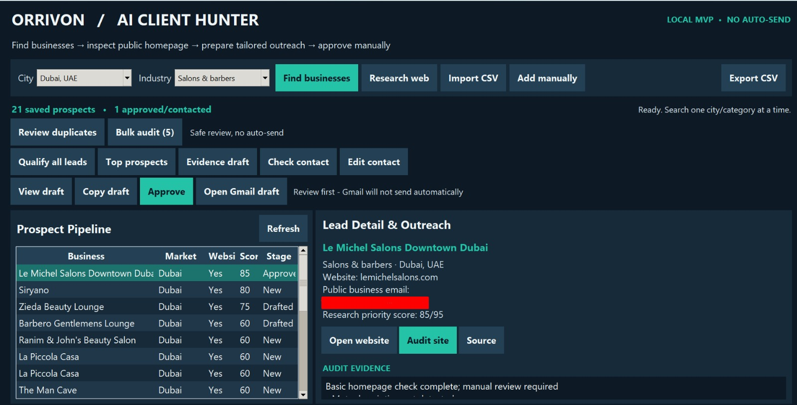

# Orrivon AI Client Hunter

**A local Windows desktop MVP for discovering B2B prospects, reviewing public websites, prioritizing leads, and preparing personalized outreach.**

Built with **Python, Tkinter, SQLite, and optional local AI (Ollama)**. Outreach is reviewed and sent manually — **no automatic emailing or mass messaging**.



## What it does

Orrivon brings basic business prospect research and outreach preparation into one desktop workspace:

- **Business discovery:** Find public business listings by city and industry using the Geoapify Places API.
- **Prospect pipeline:** Store leads locally in SQLite, update statuses, and import/export CSV.
- **Website checks:** Inspect public homepage HTML for titles, meta descriptions, mobile viewport tags, HTTPS, and contact/booking links.
- **Lead qualification:** Calculate a research-priority score and view top outreach-ready prospects.
- **Duplicate review:** Identify potential duplicate listings for manual review.
- **Outreach drafting:** Create evidence-based emails or optionally use local Ollama to choose a relevant business benefit.
- **Human approval:** Preview, edit, copy, and approve drafts before outreach.
- **Gmail handoff:** Open an **unsent, prefilled Gmail composition** with the recipient, subject, and message. The user must review and press **Send**.

**Note:** Email-format checks do not verify inbox ownership or deliverability. Website findings are preliminary. Scores reflect **outreach readiness**, not business quality or proven need.

## Tech stack

| Component | Technology |
| --- | --- |
| Desktop interface | Python, Tkinter |
| Local database | SQLite |
| Business discovery | Geoapify Places API (key required) |
| Website inspection | Python `urllib` and `html.parser` |
| Optional local AI | Ollama + `qwen2.5:0.5b` |
| Email workflow | Browser-based Gmail compose (manual send) |
| Automated tests | Python `unittest` |

Core Python code uses the **standard library**, so `pip install` is not required. Internet access is needed for live discovery, website audits, and Gmail. Geoapify availability and quotas depend on the provider's terms.

## Quick start (Windows)

### 1. Get the project

```powershell
git clone https://github.com/rajasaifdev/orrivon-ai-client-hunter.git
cd orrivon-ai-client-hunter
```

Alternatively, download the repository as a ZIP and open the extracted folder in VS Code.

### 2. Launch the final application

```powershell
python orrivon_final.py
```

If `python` is not recognized, try `py orrivon_final.py`. To check Tkinter, run `python -m tkinter`.

### 3. Configure business discovery

Click **Find businesses**. On first use, the application prompts for a Geoapify Places API key and saves it **outside the project** at:

```text
%USERPROFILE%\.orrivon\geoapify_key.txt
```

You may also set the `GEOAPIFY_API_KEY` environment variable. **Never commit or share your API key.** You can still add or import leads manually without a discovery key.

### 4. Prepare an outreach draft

1. Select a **city** and **industry**, then click **Find businesses**.
2. Choose a lead; use **Open website**, **Audit site**, or **Check contact** to review its information.
3. Use **Qualify all leads** or **Top prospects** to prioritize your research.
4. Click **Evidence draft**, then **View draft** to review the email.
5. If needed, edit the message and click **Save edited draft**.
6. Click **Approve**, then **Open Gmail draft**.
7. Check the recipient and wording in Gmail. **Nothing is sent automatically.** Mark the prospect **Contacted** only after sending an appropriate message yourself.

## Optional local AI

1. Install [Ollama](https://ollama.com/download).
2. Download the small model:

   ```powershell
   ollama pull qwen2.5:0.5b
   ```

3. Keep Ollama running locally.
4. Select a prospect and click **Local AI (optional)**.

The normal **Evidence draft** works without Ollama. AI outputs require human review.

## Project structure

```text
orrivon-ai-client-hunter/
├── app.py                  # Tkinter UI and Geoapify discovery
├── core.py                 # SQLite, website checks, drafting helpers
├── orrivon_pro.py          # Duplicate review and bulk audit
├── orrivon_final.py        # Final qualification and Gmail workflow
├── requirements.txt        # Standard-library-only Python dependencies
├── tests/
│   └── test_core.py        # Automated tests
├── screenshots/
│   └── dashboard.jpeg      # Dashboard screenshot
├── data/                   # Local SQLite database; gitignored
├── .gitignore
└── README.md
```

Keep local databases, exported contact lists, and API credentials out of public repositories.

## Tests

Run:

```powershell
python -m unittest discover -s tests -v
```

The current suite has **7 tests** for business-search queries, URL safety, homepage analysis, CSV injection protection, SQLite storage/export, factual drafting, and missing websites.

## Limitations and responsible use

- Public business data and emails may be missing, inaccurate, or out of date; independently verify contact information.
- A valid email format does **not** prove deliverability, identity, or consent.
- The automated homepage check is **not** a complete SEO, accessibility, performance, or security audit.
- Respect `robots.txt`, site terms, API rate limits, applicable outreach laws, and opt-out requests.
- Do not use the tool for unsolicited mass messaging. Every send must be a manual decision.
- Respect provider attribution and data-license requirements, including [© OpenStreetMap contributors](https://www.openstreetmap.org/copyright), where applicable.
- This project is a **local prototype**; it does not include hosted CRM integration or automatic email sending.

## Roadmap

- Stronger lead filtering and source verification
- Exportable website-review reports
- Opt-out tracking and pipeline analytics
- Portfolio demo video and case studies
- Optional integration with a separate CRM

---

**Built by Saif | Orrivon Digital**  
*Portfolio project — local desktop MVP*
